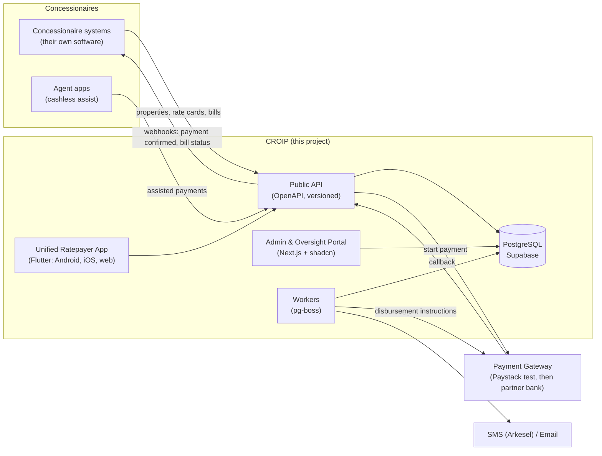
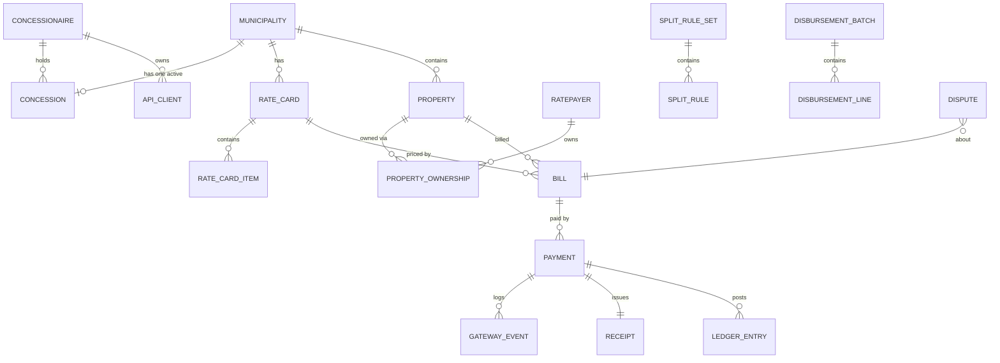
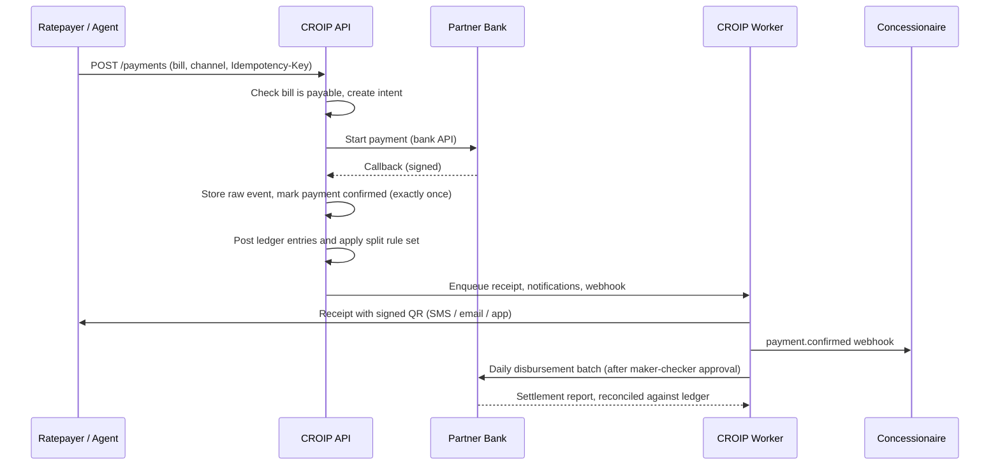

# CROIP Core Platform — Development Plan

**Scope:** Build CROIP first: the government-operated platform, its admin portal, the public concessionaire API, the payment platform and the unified ratepayer app.
**Stack:** TypeScript (platform, API, admin) · Flutter (ratepayer mobile app) · PostgreSQL on local Supabase · Next.js + shadcn/ui · OpenAPI 3.1 contract · GitHub Enterprise (`Leve10-Ghana`)
**Hosting target:** Data centre (self-hosted)
**Team:** 2 developers
**Based on:** [Approach 2 - Meeting Decisions](file:///Users/realkofi.d/.gemini/antigravity-ide/brain/09490939-b639-4635-aafa-fc115a6b0c33/approach2_meeting_decisions.md)

---

## 1. What we are building



**Platform responsibilities (from the decisions doc)**

| Area | CROIP does |
|---|---|
| Standards | Publishes the API and data standards. Onboards and offboards concessionaires. |
| Register | Holds the national property and ratepayer register, fed by concessionaires. |
| Rate cards | Verifies each municipality's rate card. Bills can't be paid until their rate card is verified. |
| Bills | Receives bills calculated by concessionaires and recomputes each one against the verified rate card. |
| Payments | Runs the payment platform through a pluggable payment gateway: Paystack (test mode) during development, then the partner bank once it is chosen. Stores the gateway's response. Providers and keys are set up in the admin portal. |
| Receipts | Issues receipts with a signed QR code. Sends notifications by SMS, email and in-app. |
| Money | Applies split rules and instructs daily disbursement. Money never sits in municipal or concessionaire accounts. |
| Oversight | Dashboards, disputes, audit log, and role-based access for the government team. |

---

## 2. Technology choices

| Layer | Choice | Why |
|---|---|---|
| Language | **TypeScript** (strict) for platform, API, workers and admin. **Dart** for the Flutter app | Shared rules live in TypeScript. The Flutter app talks to the platform only through the generated API client. |
| Runtime | Node.js LTS | Stable, supported by every tool here. |
| Monorepo | **pnpm workspaces + Turborepo** | Shared packages (types, rating engine, UI), cached builds, simple for 2 developers. The Flutter app sits in the same repo under `apps/ratepayer_app` (managed by Flutter, not pnpm). |
| Admin web app | **Next.js (App Router)** | Admin & Oversight Portal. Server components work well for dashboards. |
| Ratepayer app | **Flutter** (Android + iOS, optional Flutter web) | Fast cross-platform development. Uses `supabase_flutter` for auth and a Dart client generated from the OpenAPI spec. |
| UI | **shadcn/ui** + Tailwind CSS, Radix primitives, TanStack Table, Recharts | Shared component library in `packages/ui`. |
| Forms / validation | React Hook Form + **Zod** | Zod schemas are shared between UI, API and DB inputs. |
| API contract | **OpenAPI 3.1** (see 2.1) | The published standard for concessionaires and the source for generated TypeScript and Dart clients. |
| API service | **Hono** + `@hono/zod-openapi` (Node) | Generates the OpenAPI spec from the same Zod schemas that validate requests, so spec and code can't drift. Kept separate from the admin app so it can scale and be versioned on its own. |
| Database | **PostgreSQL via local Supabase** (Supabase CLI + Docker) | Postgres, Auth, Storage, Studio and a mail catcher, all local. The same stack can be self-hosted in a data centre. |
| Migrations | **Supabase CLI SQL migrations** (`supabase/migrations`) | Plain SQL is the source of truth, including RLS policies, triggers and functions. |
| DB access (TS) | **Kysely** with types generated from the database | Type-safe SQL without hiding Postgres features. Raw SQL is fine for ledger work. |
| Auth | **Supabase Auth** for people (internal staff, ratepayers with phone OTP). **OAuth2 client credentials** for concessionaire systems | Different trust levels for people and machines. |
| Authorization | RBAC tables + custom JWT claims (Supabase auth hook) + **RLS** | Enforced in the database, not only in the UI. |
| Background jobs | **pg-boss** (Postgres-backed queue) | No extra infrastructure. Runs webhooks, notifications, reconciliation and disbursement. |
| Integrations | **Provider adapters set up in the admin portal**: Paystack (test) and mock gateway for payments, Arkesel for SMS, SMTP for email | Provider choice and credentials are managed in the admin UI (encrypted in the database), not hard-coded or held in env files. |
| File storage | Supabase Storage | Rate card documents, valuation evidence. |
| Testing | Vitest (unit), Hono test client (API), **pgTAP** (RLS and SQL), Playwright (admin end to end), `flutter test` + integration tests (app) | |
| Code quality | ESLint, Prettier, `tsc --noEmit`, `dart analyze`, Husky + lint-staged, Commitlint | |
| API docs | Scalar or Redoc, rendered from the generated OpenAPI spec | Published to concessionaires as the "standard". |

### 2.1 API approach: recommendation

OpenAPI is a **specification format**, not a framework. You still need something to build the API with. There are two ways to work with it:

| | Spec-first | **Code-first (recommended)** |
|---|---|---|
| How | Write `openapi.yaml` by hand, then generate server stubs and clients | Define routes with Zod schemas in Hono. The OpenAPI 3.1 spec is generated from the code |
| Drift risk | High: the spec and the code can disagree | None: validation and docs come from the same schema |
| Speed for 2 developers | Slower | Faster |
| Output for concessionaires | `openapi.yaml` | Same `openapi.yaml`, committed to the repo and versioned |

**Recommendation:** use **OpenAPI 3.1 as the published contract, generated code-first with Hono + Zod**.
- The generated `openapi.yaml` is committed under `packages/contracts/openapi/`. CI fails if it's out of date.
- From that file we generate:
  - a **TypeScript client** for the admin portal
  - a **Dart client** for the Flutter app (`openapi-generator`, `dart-dio`)
  - the **public docs** for concessionaires.
- Breaking changes need a new version (`/v2`). Non-breaking additions are allowed within `/v1`.

> [!NOTE]
> **Hosting: data centre.** Local Supabase is for development. Production runs as **self-hosted Supabase (Docker) in a data centre**, which keeps data in-country. Avoid features that only exist on Supabase Cloud (for example managed Edge Functions and branching). All logic lives in Postgres, the Hono API and the worker, so the move is low-risk.

---

## 3. Repository structure (GitHub Enterprise)

**Repo:** `Leve10-Ghana/croip` (private, single monorepo)

```
croip/
├─ apps/
│  ├─ admin/            # CROIP Admin & Oversight Portal (Next.js + shadcn)
│  ├─ ratepayer_app/    # Unified ratepayer app (Flutter: Android, iOS, web)
│  ├─ api/              # Public + internal API (Hono, generates OpenAPI 3.1)
│  └─ worker/           # pg-boss workers: webhooks, notifications, disbursement
├─ packages/
│  ├─ ui/               # shadcn components, theme, shared layouts
│  ├─ db/               # Kysely client, generated DB types, query helpers
│  ├─ contracts/        # Zod schemas = the published data standard
│  │  └─ openapi/       # Generated openapi.yaml (committed, versioned)
│  ├─ api-client-ts/    # Generated TypeScript client (admin)
│  ├─ api-client-dart/  # Generated Dart client (Flutter app)
│  ├─ rating/           # Rate card model + bill recomputation engine
│  ├─ ledger/           # Double-entry posting helpers, split rules engine
│  ├─ payments/         # PaymentGateway interface + adapters (mock, Paystack, partner bank)
│  ├─ notify/           # SMS / email / in-app adapters (Arkesel, SMTP, mock)
│  ├─ auth/             # RBAC permissions, role definitions, guards
│  └─ config/           # eslint, tsconfig, tailwind presets
├─ supabase/
│  ├─ config.toml
│  ├─ migrations/       # SQL migrations (source of truth)
│  ├─ seed.sql          # Sample municipalities, concessionaires, roles, rate cards
│  └─ tests/            # pgTAP tests for RLS and functions
├─ docs/
│  ├─ adr/              # Architecture Decision Records
│  ├─ api/              # Integration guide for concessionaires
│  └─ runbooks/
├─ .github/
│  ├─ workflows/        # ci.yml, db.yml, e2e.yml
│  ├─ CODEOWNERS
│  ├─ pull_request_template.md
│  └─ ISSUE_TEMPLATE/
├─ .env.example
├─ turbo.json
└─ pnpm-workspace.yaml
```

---

## 4. Data model (first version)



| Group | Tables | Notes |
|---|---|---|
| Organisation | `regions`, `municipalities`, `concessionaires`, `concessions` (with start/end dates, status) | One active concession per municipality, enforced by an exclusion constraint. Offboarding ends a concession. History is kept. |
| Machine access | `api_clients` (hashed secret, scopes, IP allow-list), `webhook_endpoints`, `webhook_deliveries` | Concessionaire systems authenticate with OAuth2 client credentials. |
| People & RBAC | `profiles`, `roles`, `permissions`, `role_permissions`, `user_roles` (with optional region/municipality scope) | Internal roles from the decisions doc. Ratepayers are a separate audience. |
| Register | `ratepayers`, `properties` (Ghana Post GPS address, geometry, class, use), `property_ownership`, `property_submissions` (walk-in and agent registrations) | Records come from concessionaires. CROIP keeps the national record. |
| Rate cards | `rate_cards` (version, status: `draft → submitted → verified / rejected → superseded`), `rate_card_items` (class, use, zone, rate, minimum, rebates), `rate_card_reviews` | Only `verified` rate cards can price payable bills. |
| Bills | `bills` (amount from concessionaire, `rate_card_id`, CROIP's recomputed amount, `validation_status`, `payable` flag), `bill_lines` | `payable = rate card verified AND bill validated`. |
| Payments | `payment_intents`, `payments`, `gateway_events` (raw callback payloads, append-only), `receipts` (number, signed QR token) | Idempotency keys on every write. |
| Ledger | `ledger_accounts`, `ledger_transactions`, `ledger_entries` (debit/credit, must balance) | Append-only. Corrections are reversing entries. |
| Split & disbursement | `split_rule_sets` (versioned, maker-checker), `split_rules`, `disbursement_batches`, `disbursement_lines`, `bank_settlements` | |
| Oversight | `disputes`, `notifications`, `audit_log` (append-only, filled by triggers) | |
| Integrations | `integration_providers` (type: payment / sms / email, adapter, mode: test / live, status), `integration_secrets` (encrypted with Supabase Vault), `integration_changes` (maker-checker history) | Set up from the admin portal. Only one active payment provider per environment. |

**Database rules from day one**
- Money is stored as `bigint` pesewas (minor units). No floats, anywhere.
- `audit_log`, `gateway_events` and `ledger_entries` can't be updated or deleted. Grants and triggers block it.
- Every table has RLS turned on. The API's service role is used only inside the API and worker, never in a browser.

---

## 5. API surface (v1)

All endpoints sit under `/v1`, are documented in OpenAPI, and take an `Idempotency-Key` on POST.

**Concessionaire API** (client credentials, scoped to their municipalities)

| Method | Endpoint | Purpose |
|---|---|---|
| POST | `/oauth/token` | Get an access token |
| POST/GET | `/properties`, `/properties/{id}` | Register or update properties (including walk-ins) |
| POST | `/ratepayers` | Register ratepayers and link them to properties |
| POST | `/rate-cards` · GET `/rate-cards/{id}` | Submit a rate card for verification and check its status |
| POST | `/bills` · `/bills:batch` | Submit calculated bills. Response: `validated`, `rejected` (with differences), or `pending_rate_card` |
| POST | `/payments/assisted` | Agent starts a cashless payment for a ratepayer |
| GET | `/payments?since=` | Pull payment confirmations (backup to webhooks) |
| — | Webhooks | `bill.validated`, `bill.rejected`, `rate_card.verified`, `payment.confirmed`, `dispute.opened` — HMAC-signed and retried |

**Ratepayer API** (Supabase Auth session, used by the Flutter app through the generated Dart client)
- Manage account, list properties and bills, `POST /payments` (creates an intent and returns the gateway checkout URL or MoMo prompt), payment history, receipts, disputes.

**Public**
- `GET /verify/{receiptToken}`: QR verification page and API.
- `POST /gateway/callback/{provider}` (for example `/gateway/callback/paystack`): payment gateway callback. The signature is checked (Paystack: `x-paystack-signature`, HMAC-SHA512) and the raw event is stored first.

**Internal (admin)**
- Rate card review, concessionaire onboarding/offboarding, split rule management, disbursement approval, dispute handling, user and role management, **integration settings** (payment, SMS, email providers).

---

## 6. Key flows to get right

### 6.1 Rate card → bill → payable

1. The concessionaire submits a rate card. A **Rate Card Verifier** reviews and verifies it, recording who did it and when.
2. The concessionaire submits a bill that cites `rate_card_id`.
3. CROIP recomputes the bill with `packages/rating`.
   - If the amounts match → `validated`.
   - If they don't → `rejected`, with line-by-line differences.
   - If the rate card isn't verified yet → `pending_rate_card`.
4. Only bills that are `validated` and use a verified rate card are `payable` in the ratepayer app.

### 6.2 Payment → receipt → split → disbursement



**Non-negotiables**
- **Idempotency:** duplicate callbacks or retries never produce two payments.
- **Status query fallback:** a job asks the bank about any intent still pending after N minutes.
- **Signed QR:** the receipt token is an Ed25519-signed payload (receipt number, amount, date). Verification works even before a database lookup.
- **Daily reconciliation:** bank settlement report vs ledger. Any mismatch is raised to the Finance & Reconciliation Officer.
- **Maker-checker:** split rule changes and disbursement batches need two different people to approve.

### 6.3 Integrations set up from the admin portal

Payment, SMS and email providers are **set up in the admin portal, not in code or env files**. That way the government team can switch from Paystack (test) to the partner bank, or change SMS provider, without a redeploy.

| Provider type | Development | Later |
|---|---|---|
| Payment gateway | **Paystack, test mode** (GHS, MoMo and cards). Paystack Transfers (test) to exercise disbursement. Plus a local mock gateway for failure scenarios | Partner bank adapter, once the bank is chosen |
| SMS | **Arkesel** (sandbox or low-volume account). Mock adapter for local work | Arkesel live sender ID |
| Email | Local mail catcher (Supabase) | SMTP or transactional provider |

**How it works**
1. A **System Administrator** opens *Settings → Integrations*, picks an adapter (Paystack, Arkesel…), and enters keys, sender ID, callback URL and mode (`test` / `live`).
2. Secrets are stored in **Supabase Vault** (encrypted) and are never sent back to the browser. The UI only shows the last 4 characters.
3. **Test connection** checks the credentials (for example Paystack `GET /bank`, or an Arkesel balance check).
4. **Switching the active payment provider, or moving any provider to `live`, needs maker-checker approval** from a second admin. The change is recorded in `integration_changes` and `audit_log`.
5. The API and worker read the active provider at runtime (cached briefly), through the `PaymentGateway` / `SmsSender` interfaces.

> [!WARNING]
> Paystack is a **test stand-in** for the partner bank. In Paystack's model, funds settle to a Paystack merchant account, which doesn't match the final "money goes to the partner bank" design. Keep all Paystack-specific logic inside its adapter.

---

## 7. RBAC (internal government team)

| Role | Key permissions |
|---|---|
| Executive / Oversight | `dashboard.read`, `policy.approve` |
| Super Admin | `users.manage`, `roles.manage`, `config.manage` (no finance write) |
| Concessionaire Manager | `concessionaires.manage`, `concessions.manage`, `api_clients.manage` |
| Rate Card Verifier | `rate_cards.review`, `bills.review` |
| Finance & Reconciliation | `payments.read`, `reconciliation.manage`, `disbursements.prepare` |
| Finance Approver (checker) | `disbursements.approve`, `split_rules.approve` |
| Disputes / Support | `disputes.manage`, `receipts.reissue` |
| Auditor | `*.read`, `audit_log.read` |
| System Administrator | `integrations.manage` (set up providers; switching provider or going live needs a second approver), `jobs.manage` (no finance or data write) |

**How it is enforced**
1. Permissions are defined in code (`packages/auth`) and seeded into the database.
2. A Supabase custom access-token hook adds the user's roles and scopes to the JWT.
3. RLS policies call `has_permission('x', municipality_id)`.
4. The admin UI hides what a user can't do, but the database is the real gate.
5. MFA is required for all internal users.

---

## 8. Phased plan (2-week sprints)

| Phase | Sprints | Deliverables | Exit criteria |
|---|---|---|---|
| **0. Foundation** | S1 | `Leve10-Ghana/croip` repo, monorepo scaffold, CI, local Supabase, `.env.example`, shadcn theme in `packages/ui`, admin shell with login, Flutter app skeleton, ADRs 001–006 (including "OpenAPI code-first") | Both developers run `pnpm dev`, `supabase start` and `flutter run` from a clean clone in under 15 minutes. CI is green. |
| **1. Organisation & access** | S2–S3 | Regions, municipalities, concessionaires, concessions (onboard/offboard), API clients + OAuth2 token endpoint, RBAC tables, auth hook, RLS, audit log triggers, user/role admin screens | A concessionaire client can get a token and is limited to its municipalities. pgTAP tests pass. |
| **2. Register** | S4–S5 | Property and ratepayer APIs (including walk-in submissions), property map/list in admin, published `openapi.yaml` v0.1, generated TS and Dart clients, API docs | A sample concessionaire integration loads 1,000 properties through the API. |
| **3. Rate cards & bills** | S6–S7 | Rate card submission and verification workflow, `packages/rating` engine, bill submission and recomputation, payable logic, webhooks | Bills on unverified rate cards can't be paid. Mismatched bills are rejected with differences. |
| **4. Payments, receipts & integrations** | S8–S10 | **Integration settings screen** (providers, Vault secrets, test connection, maker-checker), `PaymentGateway` interface, **Paystack test adapter** + mock adapter, payment intents, callbacks, status polling, ledger, receipts with signed QR, `/verify` page, **Arkesel SMS adapter**, email, assisted payments | End-to-end payment on Paystack test mode. Duplicate callbacks are safe. Ledger balances. Receipt SMS arrives through Arkesel. |
| **5. Split & disbursement** | S11–S12 | Split rule sets (versioned, maker-checker), split at confirmation, daily disbursement batch (Paystack Transfers in test), settlement import and reconciliation, finance screens | A day's payments reconcile to the pesewa against the ledger and the batch. |
| **6. Ratepayer app (Flutter)** | S13–S14 | Phone OTP login, link properties, bills across municipalities, pay (Paystack checkout / MoMo), history, receipts with QR, disputes, push notifications | A ratepayer pays bills from two municipalities with different concessionaires in one account, on Android and iOS. |
| **7. Oversight & disputes** | S15 | Executive dashboards (billed vs collected, by municipality and concessionaire), concessionaire KPIs, dispute workflow | Oversight role sees national figures. Auditor can trace any payment end to end. |
| **8. Hardening & pilot** | S16–S17 | Security review, load test, **self-hosted Supabase deployment in the data centre** (staging), backups and monitoring, concessionaire sandbox, integration guide, partner bank adapter (once chosen), app store builds, runbooks, handover docs | One pilot municipality live in the data-centre staging environment with a real concessionaire integration. |

That is roughly **8 months** for 2 developers. Phases 6 and 7 can run alongside 4–5 once the API is stable.

---

## 9. Working as two developers on GitHub Enterprise

**Repository settings**
- `main` is protected: PR required, **1 approval from the other developer**, CI must pass, linear history (squash merge), no force-push.
- `CODEOWNERS`: both developers on everything. `supabase/migrations/` and `packages/ledger/` need a review every time.
- Turn on secret scanning, push protection, Dependabot alerts and updates, and CodeQL (part of GitHub Advanced Security, if licensed).
- Environments: `dev` → `staging` → `production`, with required reviewers on production.

**Workflow**
- Trunk-based development with short-lived branches: `feat/CROIP-123-rate-card-verify`, `fix/...`, `chore/...`.
- Conventional Commits, enforced by Commitlint.
- GitHub Projects board: Backlog → Ready → In Progress → In Review → Done. One issue per PR.
- **Migrations:** one developer owns a migration at a time. Name files with a timestamp (`supabase migration new <name>`). Rebase before merging. CI runs `supabase db reset` to prove all migrations apply from scratch.
- Write an ADR for every significant decision (for example "ADR-004: Money stored as bigint pesewas").

**Suggested ownership split**

| Developer A — Platform & Money | Developer B — Product & Experience |
|---|---|
| Supabase schema, RLS, RBAC, audit | `packages/ui`, admin portal screens |
| API service, OAuth2, webhooks, OpenAPI generation | **Flutter ratepayer app** (Dart client, OTP, payments UI) |
| Payments, Paystack/bank adapters, ledger, split, disbursement | Rate card review UI, register screens, integration settings UI |
| Workers, Arkesel/email adapters, reconciliation | Dashboards, disputes UI |
| Concessionaire API docs | Playwright + Flutter integration tests |

Swap at least one feature per phase so both developers know the whole system before handover.

**CI pipeline (`.github/workflows/ci.yml`)**
1. `pnpm install --frozen-lockfile`
2. `turbo lint typecheck test`
3. `supabase start` → `supabase db reset` → `supabase test db` (pgTAP)
4. API integration tests against the local database (Paystack calls stubbed)
5. Check that generated DB types, `openapi.yaml`, and the TS and Dart clients are up to date (fails if not regenerated)
6. **Flutter job** (`flutter.yml`, runs only when `apps/ratepayer_app/**` or the Dart client changes): `flutter pub get` → `dart analyze` → `flutter test` → debug APK build
7. Playwright smoke tests (on PRs to `main`)

---

## 10. Local development setup

```bash
# prerequisites: Node LTS, pnpm, Docker Desktop, Supabase CLI, gh CLI, Flutter SDK, Java (for openapi-generator)
gh repo clone Leve10-Ghana/croip && cd croip
pnpm install
supabase start                 # Postgres, Auth, Studio, Storage, mail catcher
supabase db reset              # apply migrations + seed.sql
pnpm db:types                  # generate TS types from the local DB
pnpm api:generate              # openapi.yaml -> TS + Dart clients
cp .env.example .env.local     # only infra values (DB URL, JWT secret) - provider keys go in the admin UI
pnpm dev                       # admin :3000, api :4000, worker
cd apps/ratepayer_app && flutter run   # Android emulator / iOS simulator / Chrome
```

Seed data: 3 regions, 6 municipalities, 3 concessionaires, one verified and one draft rate card, 200 properties, test ratepayers, one user for each internal role. Integrations are seeded with the **mock** gateway and SMS adapters active. Each developer adds their own Paystack test keys and Arkesel key in *Settings → Integrations*.

---

## 11. Security & compliance checklist

- Ghana **Data Protection Act, 2012 (Act 843)**: register as a data controller, collect only the personal data needed, have a retention policy.
- Encrypt in transit (TLS) and at rest. Encrypt Ghana Card numbers at the column level.
- No secrets in the repo. Infrastructure secrets go in GitHub Environments (CI) and the data centre's secret store. Provider keys go in Supabase Vault through the admin UI.
- Check signatures on gateway callbacks, allow-list the gateway's IPs, block replays (timestamp + nonce).
- Rate-limit public endpoints and the `/verify` endpoint.
- Flutter app: certificate pinning, secure storage for tokens, no secrets in the app bundle, obfuscated release builds.
- Data centre: network segmentation (database not reachable from the internet), encrypted backups with restore drills, centralised logs and monitoring.
- OWASP ASVS L2 (platform) and OWASP MASVS (mobile) as security targets. Independent penetration test before the pilot.

---

## 12. Risks

| Risk | Mitigation |
|---|---|
| Partner bank not yet chosen | Build against the `PaymentGateway` interface. Use Paystack test mode plus a mock gateway for now. Add the bank adapter once it is chosen, switched over from the admin portal. |
| Paystack's settlement model differs from the final bank design | Paystack is used for testing only. Keep its logic isolated in the adapter, and keep the ledger and disbursement design bank-neutral. |
| Two languages (TypeScript + Dart) | The Flutter app uses only the generated Dart client, with no business rules in the app. Bill and rate logic stays on the server. |
| Rate card formats differ by municipality | Model rate cards as structured, versioned rules. Start with 2–3 real rate cards to test the model in Phase 3. |
| Split rules not yet set by government | Rule sets are data, not code. Placeholder percentages are clearly marked. |
| Existing concessionaire systems are hard to integrate | Publish the API and sandbox early (end of Phase 2). Collect feedback from the 3–4 existing players. |
| Data centre readiness (hardware, network, ops team) | Start the infrastructure request early. Use Docker Compose for self-hosted Supabase so staging can run anywhere until the data centre is ready. |
| Handover to government team | Docs, runbooks and ADRs are maintained throughout. Plan training in Phase 8. |

---

## 13. Decisions log

| Topic | Decision |
|---|---|
| GitHub Enterprise org | `Leve10-Ghana`. Repo: `Leve10-Ghana/croip` |
| Ratepayer app | **Flutter** (Android, iOS, optional web), for faster development |
| API | **OpenAPI 3.1** contract, generated code-first with Hono + Zod. TS and Dart clients generated from it |
| Hosting | **Data centre**, self-hosted Supabase. Local Supabase for development |
| Payments | **Paystack test mode** until the partner bank is chosen, through a pluggable adapter |
| SMS | **Arkesel** (likely) |
| Provider setup | All payment, SMS and email providers are **set up in the admin portal**, with secrets in Vault and maker-checker for switching provider or going live |

## 14. Remaining open questions

1. **Access:** besides the 2 developers, who else needs access to `Leve10-Ghana/croip`, for example a government technical lead (read-only)?
2. **Flutter web:** should the Flutter app also be released as a web app for ratepayers without smartphones, or is a USSD channel planned instead?
3. **Data centre:** which facility (for example NITA, or a private Tier III provider), and when can a staging environment be provisioned?
